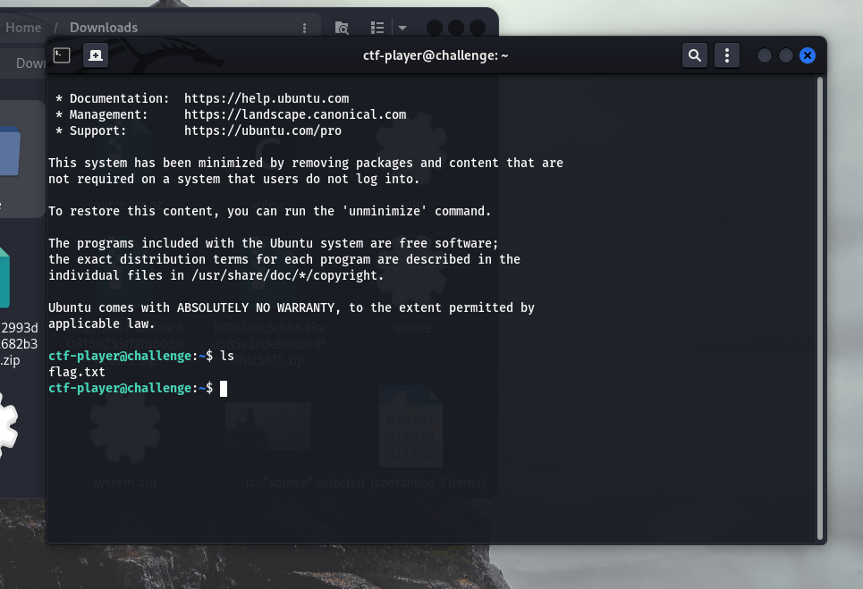
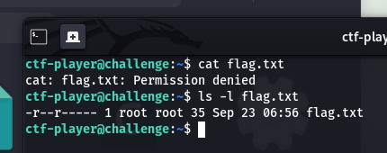
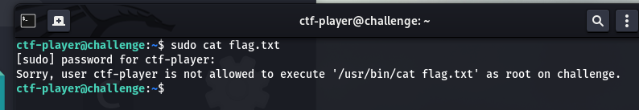
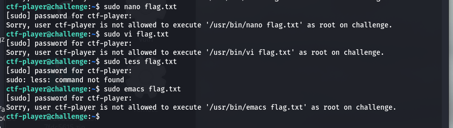
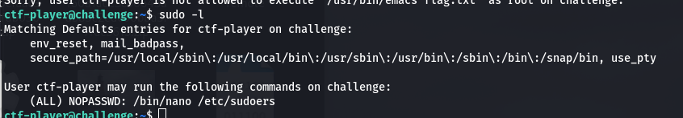
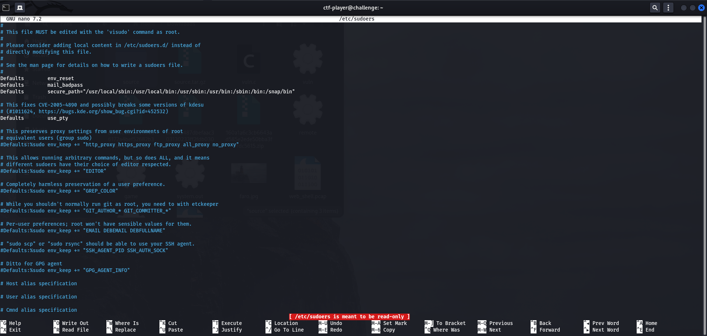
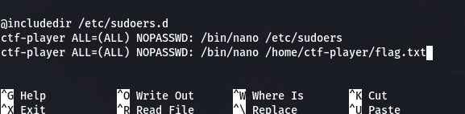
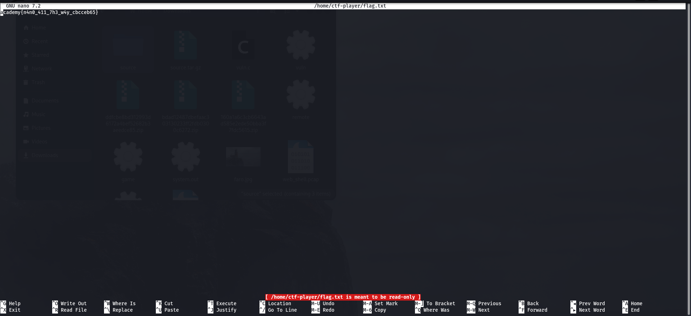

# ABSOLUTE NANO (picoCTF 2026)

> General Skils, Medium

*You have complete power with nano.*

*Think you can get the flag?*

## Explorando el entorno

El reto consiste en una instancia a la que hay que conectarse por ssh. Ya de entrada podemos ver la flag en el home de nuestro usuario:

Pero no podemos ver que contiene, ya que no tenemos permisos:

Bueno, con `sudo`:

Bueno, con alguna otra cosa que no sea `cat`

Bueno.

## *Qué* podemos usar con sudo?

Con razón *complete power with nano*. Vamos a editar *sudoers* para darle permisos a nuestro usuario:

*yendo al final del todo copiamos el permiso que ya tenía el usuario*

Y pronto:

