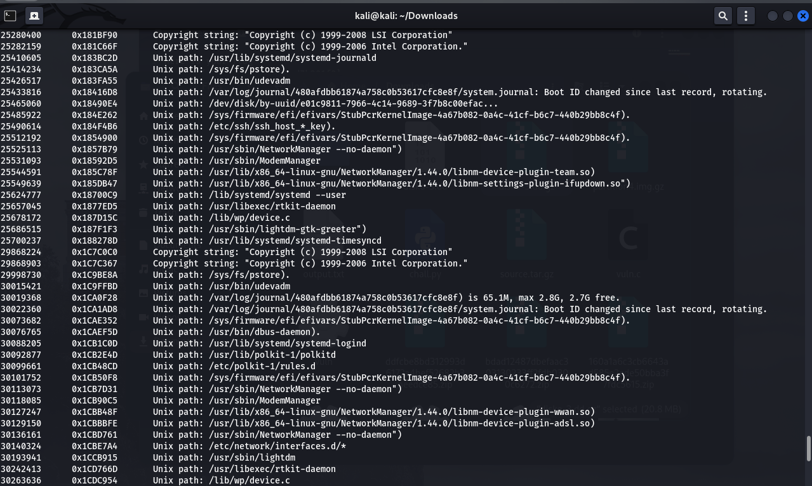
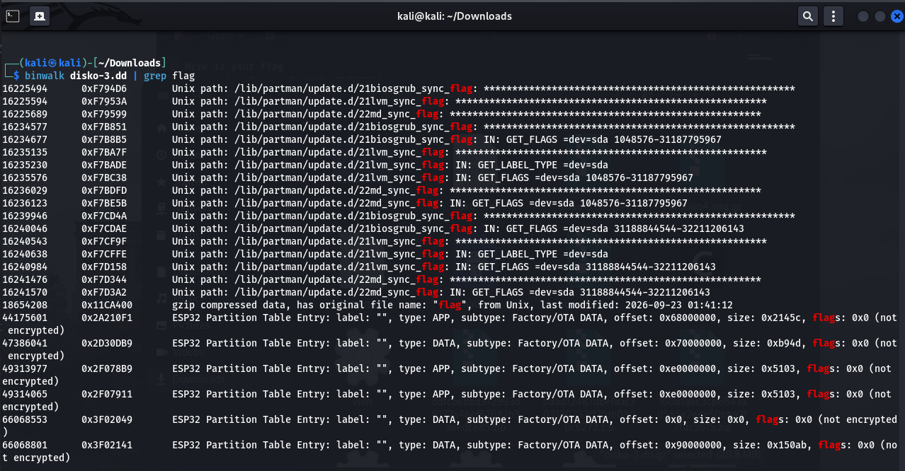
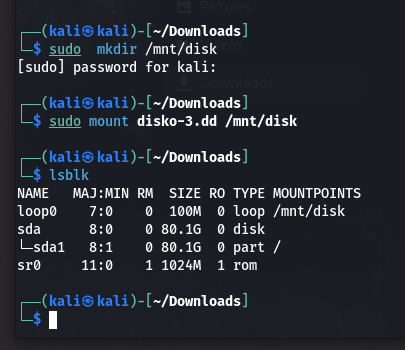
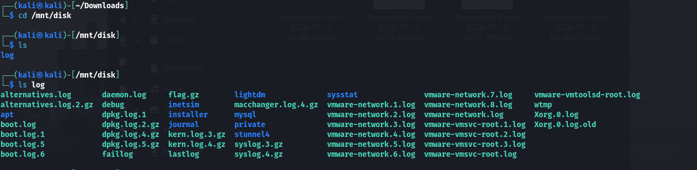
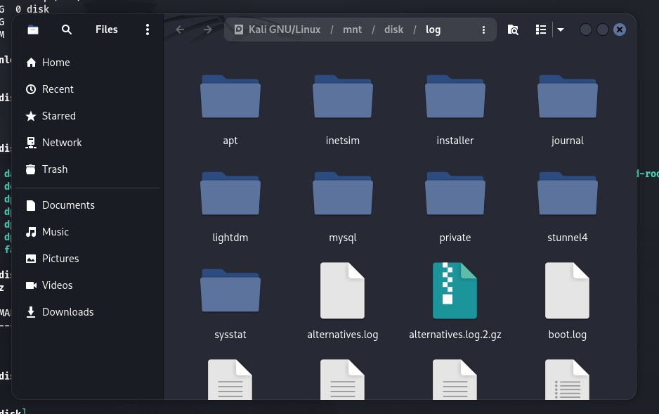
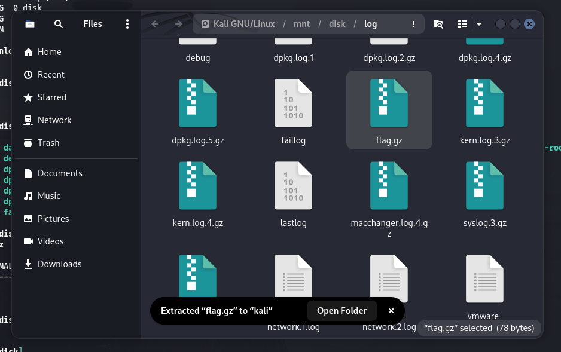
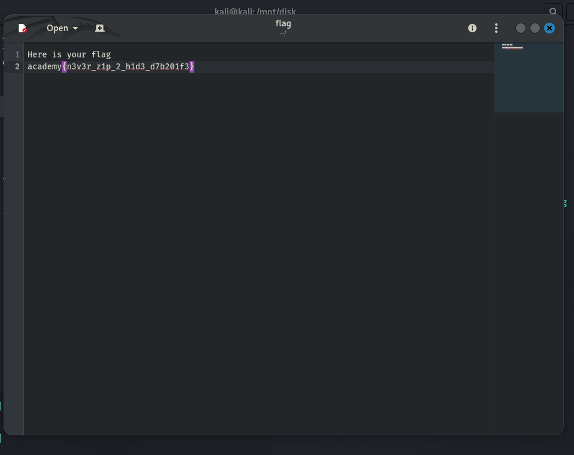

# DISKO 3 (picoCTF 2026)

> Forensics, Medium

*Can you find the flag in this disk image? This time, its not as plain as you think it is!*

Luego de descargar `disko-3.dd.gz`, lo extraemos y se lo pasamos a `binwalk`:



Parece ser la imagen del / de un linux. Si hilamos más fino con un binwalk recursivo y `grep`eando la flag:



```
gzip compressed data, has original file name: "flag", from Unix, last modified: 2026-09-23 01:41:12
```

Hay un `flag.gz` en la imagen, así que ya estaría pronto. Montamos la imagen para acceder con el explorador de archivos:







Y extraemos la flag:




