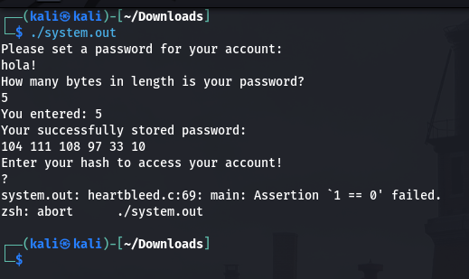
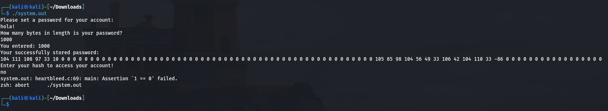
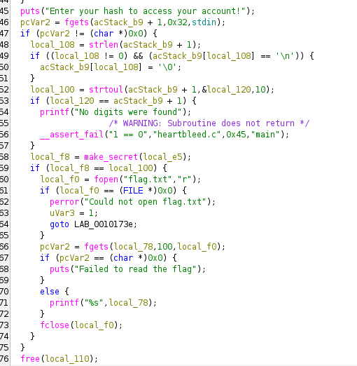
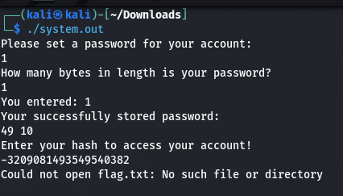
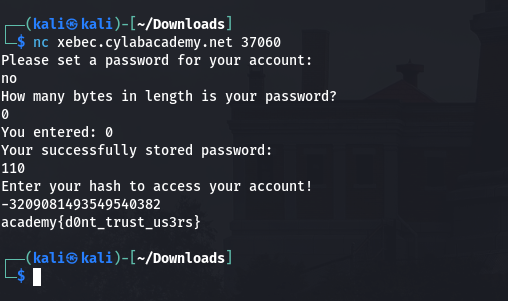

# Secure Password Database (picoCTF 2026)

> Reverse Engineering, Medium

*I made a new password authentication program that even shows you the password you entered saved in the database! Isn't that cool?*

## Viendo cómo funciona el programa

Ejecutando el programa:



Vemos que:
- El programa pide una contraseña nueva y el largo de esta.
- Imprime la contraseña ingresada como un string de valores ASCII.
- Luego pide el hash de la contraseña ingresada para "acceder a la cuenta".
- Al ingresar "?" termina con error al no poder leer un valor númerico.

El error refiere al programa como "hearbleed.c", por lo que ahí tenemos una pista. Probando ejecutar con un largo de contraseña más grande:



Al pasarle 1000 como largo el programa hace un *buffer over-read* e imprime parte de la memoria del programa.

Podemos ver un **105 85 98 104 56 49 33 106 42 104 110 33 -86**. Ignorando el -86 que no es ASCII válido, nos quedamos con "iUbh81!j*hn!". Esta debe ser a contraseña que devuelve la flag, por lo que falta determinar cómo sería el hash.

## Desensamblando con Ghidra

Yendo al final de main, cuando pide ingresar el hash:



Vemos que hace los chequeos normales (que se leyeron >= 1 caracteres, que se cambie el salto de línea por el caracter nulo) y luego intenta pasar el string leído a un entero (si falla acá es que sale el mensaje de error con la pista de heartbleed).

En la línea 58, llama a la función *make_secret* y luego compara el output con el número leído del usuario. Si coinciden, abre *flag.txt* e imprime el contenido.

### make_secret

```
void make_secret(long param_1) {
  long local_10;
  
  for (local_10 = 0; obf_bytes[local_10] != '\0'; local_10 = local_10 + 1) {
    *(byte *)(local_10 + param_1) = obf_bytes[local_10] ^ 170;
  }
  *(undefined1 *)(param_1 + 12) = 0;
  hash(param_1);
  return;
}
```

Acá Ghidra ya empieza a enredarse un poco. En *main*, se pasa como argumento a *local_e5*, que es un array de largo 13, pero la función se decompiló con un parámetro *long* y termina con casteos y aritmética de punteros gratuitos.

Pero, a grandes rasgos, lo que hace la función es:
- Recibe un buffer de largo 13
- Recorre el buffer, para cada elemento lo substituye por el elemento correspondiente en un buffer global (*obf_bytes*) y con un XOR 170.
- Le pasa el buffer a una función *hash*.

Podemos asumir que *obf_bytes* es el string que encontramos al inicio con el *buffer over-read*.

### hash

```
long hash(byte *param_1) {
  byte *local_20;
  long local_10;
  
  local_10 = 5381;
  local_20 = param_1;
  while( true ) {
    if (*local_20 == 0) break;
    local_10 = (long)(int)(uint)*local_20 + local_10 * 33;
    local_20 = local_20 + 1;
  }
  return local_10;
}
```

Bien sencillo:
- Recibe el buffer y define una variable *local_10* inicializada en 5381. Sobre esta última variable se va calculando el hash.
- Recorre el buffer, para cada elemento se multiplica el valor actual de *local_10* por 33 y se le suma el elemento.
- El has resultante es el valor final de *local_10*.

## Fin

(casi) one-liner en python para caretear:

> Originalmente hice el XOR por 170 sobre los caracteres de "iUbh81!j*hn!", pero no andaba,
> y al final con el over-read ya obteníamos el buffer XOReado. Ah ta.

```
from functools import reduce as r
import ctypes as c

c.c_int64(r(lambda res, cur: res * 33 + cur, [5381] + [ord(c) for c in "iUbh81!j*hn!"])).value
```

Que da como resultado **-3209081493549540382**, que efectivamente es el valor que buscamos:



Y conectándonos a la instancia de  CyLabs obtenemos la flag:


