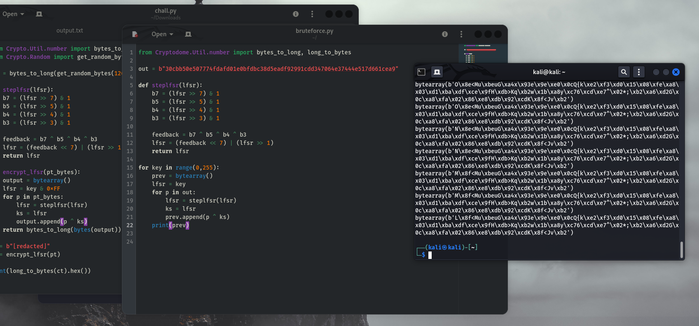
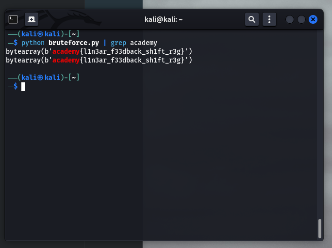

# shift registers (picoCTF 2026)

> Cryptography, Medium

*I learned about lfsr today in school so i decided to implement it in my program. It must be safe right?*

## Código + output

El reto nos da un `output.txt` con la flag cifrada y un `chall.py` con el código usado.

El código:

```
from Crypto.Util.number import bytes_to_long, long_to_bytes
from Crypto.Random import get_random_bytes

key = bytes_to_long(get_random_bytes(126))

def steplfsr(lfsr):
    b7 = (lfsr >> 7) & 1
    b5 = (lfsr >> 5) & 1
    b4 = (lfsr >> 4) & 1
    b3 = (lfsr >> 3) & 1

    feedback = b7 ^ b5 ^ b4 ^ b3
    lfsr = (feedback << 7) | (lfsr >> 1)
    return lfsr

def encrypt_lfsr(pt_bytes):
    output = bytearray()
    lfsr = key & 0xFF
    for p in pt_bytes:
        lfsr = steplfsr(lfsr)
        ks = lfsr
        output.append(p ^ ks)
    return bytes_to_long(bytes(output))

pt = b"[redacted]"
ct = encrypt_lfsr(pt)

print(long_to_bytes(ct).hex())
```

Google nos dice que *"Un LFSR (Linear-Feedback Shift Register o Registro de Desplazamiento con Retroalimentación Lineal) es un circuito lógico o algoritmo cuyo bit de entrada se calcula como una función lineal (generalmente una operación XOR) de sus estados previos."*

En criollo, es un generador de números pseudo-random con una semilla inicial, en este caso la key generada por *get_random_bytes()* de *PyCryptodome*.

Entonces, para cifrar la flag itera en cada byte, genera un nuevo número "aleatorio" con LFSR y hace un XOR entre los dos. Si tuviéramos la semilla original (la variable *key*) descifrar la flag es trivial, porque podemos generar cada estado del LFSR de nuevo y hacer XOR con cada byte del texto cifrado (recordar que si A XOR B = C => B XOR C = A y A XOR C = B).

Pero a primera vista parece ser casi imposible de romper el cifrado, porque 1. *get_random_bytes()* es criptográficamente segura y 2. la key son 126 bytes, muy largo para romperla a fuerza bruta.

## Rompiendo a fuerza bruta

El error en el código está al definir el estado inicial para el LFSR:

```
lfsr = key & 0xFF
```

Como el 0xFF es solo un byte se rellena con ceros al inicio y al hacer el AND termina anulando todo menos el último byte de *key*, **por lo que ahora solo hay 256 claves posibles**.

Snippet en Python para obtener las 256 (255, le erré al rango en el for) posibles flags:

```
# texto en output.txt
out = bytes.fromhex("30cbb50e507774fdafd01e0bfdbc38d5eadf92991cdd347064e37444e517d661cea9")

for key in range(0,255):
    prev = bytearray()
    lfsr = key
    for p in out:
        lfsr = steplfsr(lfsr)
        ks = lfsr
        prev.append(p ^ ks)
    print(prev)
```

Y ejecutándolo:



Por suerte ya sabemos el formato de la flag:


